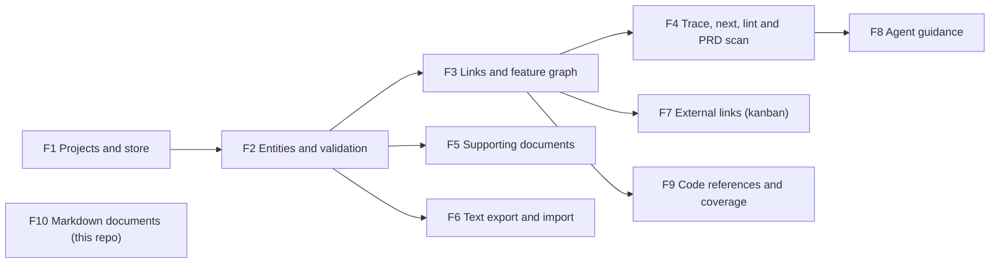

# Features

Header: `layer | needs | requirements`. A feature cannot be `in_progress` while a mandatory dependency is `planned` ([S2](specs/S2-status-and-lint.md)).

| ID | Title | Layer | Status | Needs | Requirements |
|---|---|---|---|---|---|
| F1 | Projects and store | foundation | planned | - | R1 |
| F2 | Entities and validation | foundation | planned | F1 | R2,R4,R5 |
| F3 | Links and feature graph | core | planned | F2 | R3,R9 |
| F4 | Trace, next, lint and PRD scan | core | planned | F3 | R6,R7,R8,R11 |
| F5 | Supporting documents | core | planned | F2 | R10 |
| F6 | Text export and import | foundation | planned | F2 | R13 |
| F7 | External links (kanban) | core | planned | F3 | R12 |
| F8 | Agent guidance | core | planned | F4 | R14 |
| F9 | Code references and coverage | growth | planned | F3 | R15 |
| F10 | Markdown documents (this repo) | foundation | in_progress | - | R16 |

## Dependency graph

Critical path (longest mandatory chain): F1 -> F2 -> F3 -> F4 -> F8.
